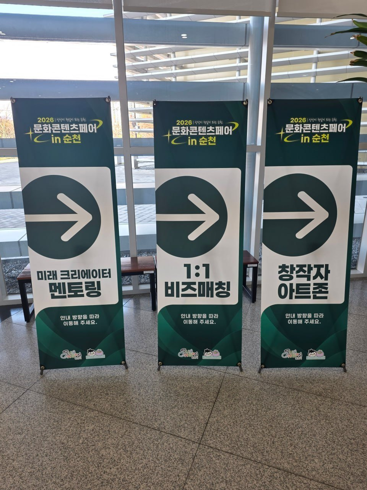
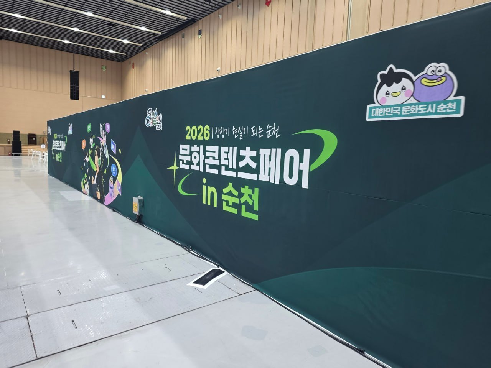
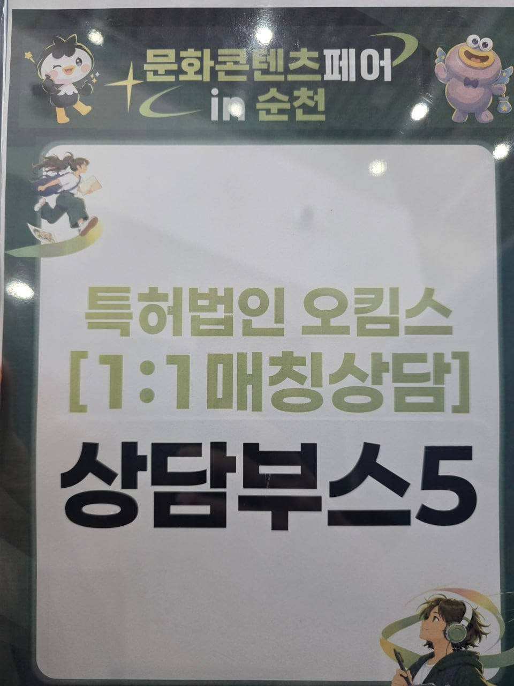

박시형 변리사가 11월 20일 순천만생태문화교육원에서 열린 「2026 문화콘텐츠페어 in 순천」에서 IP 상담부스를 운영했습니다. ‘상상이 현실이 되는 순천’을 내건 이 행사에는 미래 크리에이터 멘토링, 창작자 아트존 같은 창작자 프로그램이 함께 마련됐습니다.

오킴스가 맡은 곳은 ‘크리에이터 비즈매칭’ 프로그램의 상담부스 5번이었습니다. 크리에이터 비즈매칭은 변리사와 기업, 창작자를 1:1로 이어 주는 프로그램입니다. 상담을 원하는 창작자는 누구나 예약 페이지에서 희망 분야를 골라 신청하고, 호출 알림을 받으면 테이블을 찾아오면 됐습니다.

웹툰이나 캐릭터, 일러스트 같은 창작물은 만드는 순간 저작권이 생기지만, 그 이름과 캐릭터를 굿즈나 브랜드로 넓혀 갈 때는 사정이 달라집니다. 작품 제목이나 캐릭터 이름은 상표로, 상품에 쓰이는 캐릭터의 모양은 디자인으로 따로 출원해 두어야 다른 사람이 먼저 등록해서 생기는 분쟁을 막을 수 있습니다. 혼자 작업하는 창작자일수록 어디서부터 챙겨야 할지 막막할 때가 많아서, 변리사와 마주 앉아 바로 물어볼 수 있는 자리는 실제로 도움이 됩니다.

오킴스는 창작자와 기업이 현장에서 지식재산 이야기를 나눌 수 있는 상담과 교육 활동을 이어 가고 있습니다.

창작자를 위한 상담 자리를 마련해 주신 순천시와 행사 관계자 여러분께 감사드립니다.

