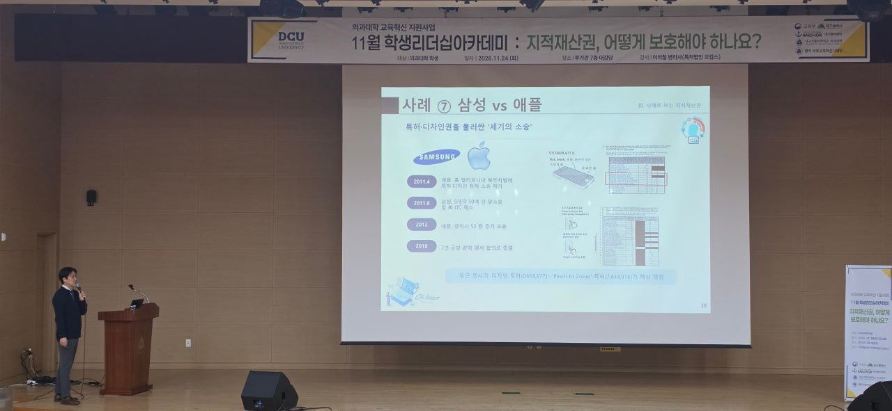

특허법인 오킴스 이의철 변리사가 2026년 11월 24일 대구가톨릭대학교 의과대학 루가관 대강당에서 열린 「11월 학생리더십아카데미」 강사로 나섰습니다. 학생리더십아카데미는 교육혁신 지원사업으로 열리는 의과대학 학생 대상 프로그램입니다. 이달 주제는 「지적재산권, 어떻게 보호해야 하나요?」였습니다.

강의 제목은 「지식재산권(IP)의 이해와 활용」이고, 'AI 앱 개발과 저작권까지'라는 부제가 붙었습니다. 지식재산권을 실제로 어떻게 활용하는지에서 출발해, 요즘 학생들이 관심을 많이 두는 앱 개발에서 IP를 어떻게 관리하면 좋은지까지 차례로 짚었습니다. 둥근 모서리 디자인과 'Pinch to Zoom' 특허로 잘 알려진 삼성과 애플의 특허·디자인 소송도 사례로 소개됐습니다.

의대생에게 지식재산권은 조금 먼 이야기로 들릴 수 있지만, 진료 현장에서 떠올린 아이디어가 의료기기나 헬스케어 앱으로 이어지는 경우는 드물지 않습니다. 앱 하나만 봐도 기능 아이디어는 특허, 이름과 로고는 상표, 화면 디자인은 디자인권, 소스코드는 저작권으로 보호하는 방식이 저마다 다르니, 개발 초기에 무엇을 어떤 권리로 지킬지 정리해 두면 좋습니다. 특허는 출원 전에 학회 발표나 논문, 앱 출시로 내용이 먼저 알려지면 권리를 받는 데 제약이 생길 수 있어, 공개 시점을 미리 따져 보는 습관도 필요합니다.

오킴스는 대학과 창업 현장에서 지식재산 교육을 이어 가고 있습니다.

자리를 마련해 주신 대구가톨릭대학교 의과대학과 강의에 함께해 준 학생들께 고마운 마음을 전합니다.

